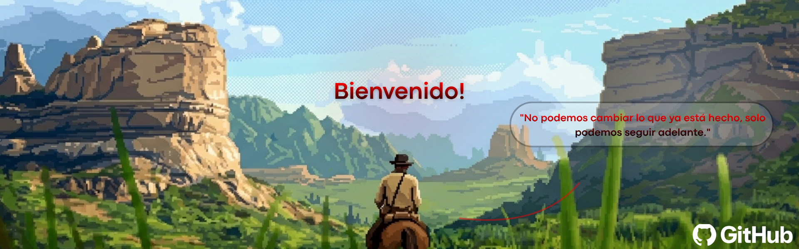
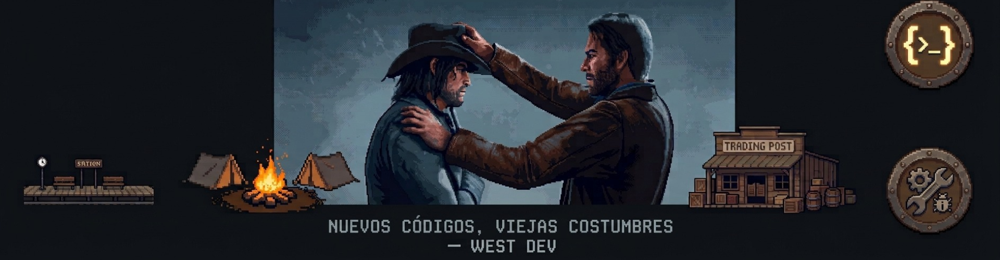

  

  &nbsp;&nbsp;

---

  
  
  

  
 

  &nbsp;

---

  

  
  
  
  
  
  
  
  
  
  
  
  
  
  

---

  <table width="100%" style="border: none; background: transparent;">
    <tr>
      <td width="60%" valign="middle" style="border: none; background: transparent;">
        <h3><b>Destacado: Personal Pisos</b></h3>
        

          Colaboración en un sitio web de diseño de interiores y su base de datos, creado por @JuliaLafaelly y otros colaboradores; este proyecto forma parte de dos cursos: Desarrollo Front-End y Modelado de Bases de Datos.
        

      </td>
      <td width="20%" align="center" valign="middle" style="border: none; background: transparent;">
        
      </td>
    </tr>
  </table>

---

  

    />
  </picture>

